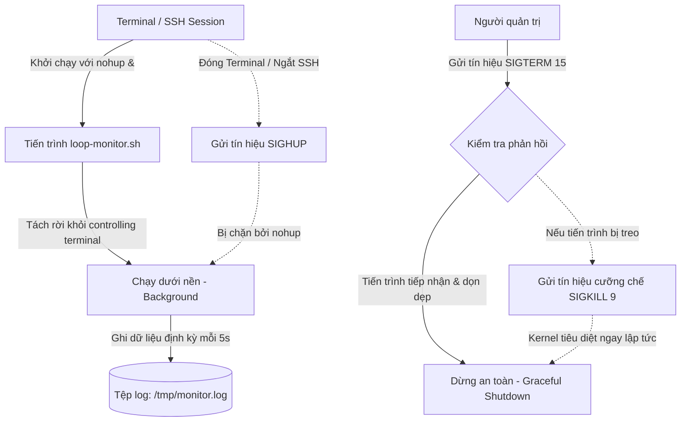

# BÁO CÁO THỰC HÀNH - BÀI 4
## CHỦ ĐỀ: QUẢN LÝ TIẾN TRÌNH NỀN VỚI NOHUP VÀ TÍN HIỆU KILL

- **Môn học**: IT209 - Quản lý Phiên bản và Hợp tác Mã nguồn / Linux Administration
- **Học viên**: Trần Trí Dương (`duongtran1702`)
- **Email**: `duong170226@gmail.com`
- **Đường dẫn bài nộp**: `ex4/`
- **Tệp mã nguồn**: [`loop-monitor.sh`](loop-monitor.sh)

---

## 1. MỤC TIÊU BÀI TẬP

1. **Khởi chạy tiến trình chạy nền độc lập**: Biết cách sử dụng lệnh `nohup` kết hợp với ký tự `&` để đưa tiến trình vào chế độ chạy nền (background), ngắt liên kết điều khiển khỏi phiên làm việc Terminal (decouple session) nhằm đảm bảo tiến trình không bị tắt khi ngắt kết nối SSH hoặc đóng Terminal.
2. **Giám sát tiến trình hệ thống**: Nắm vững các công cụ khảo sát trạng thái tiến trình bao gồm `ps aux`, `pgrep`, `top`/`htop` để xác định chính xác số định danh tiến trình (PID), mức tiêu thụ CPU, RAM và trạng thái thực thi.
3. **Quản lý tín hiệu hệ thống (Signals) với lệnh `kill`**: Hiểu rõ cơ chế giao tiếp giữa hệ điều hành và tiến trình qua Signals, thành thạo việc gửi tín hiệu dừng an toàn `SIGTERM (15)` và phân biệt với tín hiệu cưỡng chế ngắt tức thì `SIGKILL (9)`.

---

## 2. BỐI CẢNH VÀ NGUYÊN TẮC HOẠT ĐỘNG

### 2.1. Vấn đề của tiến trình chạy trên Terminal
Khi người dùng chạy một tiến trình thông qua phiên làm việc (session) của Terminal (hoặc kết nối qua SSH):
- Tiến trình con được gắn liền với thiết bị điều khiển đầu cuối (**controlling terminal / tty / pts**).
- Khi người dùng đóng Terminal hoặc ngắt kết nối SSH, tiến trình cha (thường là Shell `bash`/`zsh`) sẽ gửi tín hiệu **`SIGHUP` (Signal Hang Up - mã số 1)** đến toàn bộ các tiến trình con trong cùng Session / Process Group.
- Mặc định, nếu không được cấu hình xử lý `SIGHUP`, các tiến trình con sẽ bị hủy ngay lập tức.

### 2.2. Giải pháp: `nohup` và ký tự `&`
- **`nohup` (No Hang Up)**: Là công cụ chặn và bỏ qua tín hiệu `SIGHUP`. Nhờ đó, ngay cả khi terminal đóng lại hoặc phiên SSH kết thúc, tiến trình vẫn tiếp tục duy trì hoạt động trên hệ thống.
- **Ký tự `&`**: Yêu cầu Shell đưa tiến trình vào chạy dưới nền (**background job**), trả lại quyền điều khiển dấu nhắc lệnh ngay lập tức cho người dùng.
- **Chuyển hướng I/O (`> /dev/null 2>&1`)**: Chuyển hướng cả hai luồng Standard Output (stdout - file descriptor 1) và Standard Error (stderr - file descriptor 2) để tránh việc `nohup` tự động tạo tệp `nohup.out` trong thư mục hiện tại.

### 2.3. Sơ đồ cơ chế hoạt động của `nohup` và vòng đời tiến trình



---

## 3. MÃ NGUỒN KỊCH BẢN GIÁM SÁT (`loop-monitor.sh`)

Kịch bản được viết bằng Bash Shell, thực hiện ghi thời gian hiện tại vào tệp `/tmp/monitor.log` cứ mỗi 5 giây bằng vòng lặp vô tận:

```bash
#!/bin/bash
# ==============================================================================
# Script Name : loop-monitor.sh
# Description : Kịch bản giám sát hệ thống ghi thời gian định kỳ vào /tmp/monitor.log
# Author      : Trần Trí Dương (duongtran1702)
# ==============================================================================

LOG_FILE="/tmp/monitor.log"

while true; do
    echo "System time: $(date)" >> "$LOG_FILE"
    sleep 5
done
```

### Giải thích các thành phần mã nguồn:
- `#!/bin/bash`: Shebang chỉ định trình thông dịch Bash thực thi script.
- `while true; do ... done`: Vòng lặp vô hạn chạy liên tục cho đến khi nhận tín hiệu kết thúc từ hệ điều hành.
- `echo "System time: $(date)" >> "$LOG_FILE"`: Gọi hàm lấy thời gian hệ thống và nối thêm (`>>`) một dòng mới vào tệp nhật ký `/tmp/monitor.log`.
- `sleep 5`: Tạm dừng tiến trình trong khoảng thời gian 5 giây để giảm thiểu tải tiêu thụ CPU.

---

## 4. QUY TRÌNH THỰC HIỆN VÀ MINH CHỨNG THỰC TẾ

### Bước 1: Phân quyền thực thi cho kịch bản
Cấp quyền thực thi (`execute`) cho chủ sở hữu tệp bằng lệnh `chmod`:

```bash
chmod +x loop-monitor.sh
```

Kiểm tra quyền hạn tệp tin:
```bash
ls -la loop-monitor.sh
```
**Kết quả terminal:**
```text
-rwxr-xr-x 1 root root 361 Oct  5 17:28 loop-monitor.sh
```

---

### Bước 2: Khởi chạy kịch bản ở chế độ nền độc lập với `nohup`

Chuyển hướng Standard Output và Standard Error vào `/dev/null` để đảm bảo kịch bản chạy hoàn toàn độc lập và không tạo file rác:

```bash
nohup ./loop-monitor.sh > /dev/null 2>&1 &
```

> **Ghi chú**: Nếu không chỉ định chuyển hướng `> /dev/null 2>&1`, `nohup` sẽ mặc định xuất thông báo `nohup: ignoring input and appending output to 'nohup.out'`.

---

### Bước 3: Xác định số định danh tiến trình (PID)

Sử dụng công cụ `pgrep` để tìm PID theo tên file kịch bản:
```bash
pgrep -f loop-monitor.sh
```
**Kết quả:**
```text
549
```

Tra cứu chi tiết trạng thái tiến trình bằng `ps aux`:
```bash
ps aux | grep loop-monitor.sh
```
**Kết quả terminal thực tế:**
```text
USER       PID %CPU %MEM    VSZ   RSS TTY      STAT START   TIME COMMAND
root       549  0.0  0.0   4756  3208 pts/0    S+   17:28   0:00 /bin/bash ./loop-monitor.sh
root       554  0.0  0.0   4100  1956 pts/0    S+   17:28   0:00 grep loop-monitor.sh
```

**Phân tích thông tin từ `ps aux`:**
- **USER (`root`)**: Tiến trình đang chạy dưới quyền tài khoản root.
- **PID (`549`)**: Số định danh tiến trình duy nhất do Linux Kernel cấp phát.
- **%CPU & %MEM (`0.0%`)**: Mức chiếm dụng tài nguyên CPU và bộ nhớ cực thấp do có lệnh `sleep 5`.
- **STAT (`S+`)**: 
  - `S` (Interruptible Sleep): Tiến trình đang trong trạng thái ngủ chờ tài nguyên/hết thời gian `sleep`.
  - `+`: Tiến trình nằm trong nhóm tiến trình foreground của phiên làm việc.

---

### Bước 4: Kiểm tra tệp tin log đang được ghi liên tục

Sử dụng lệnh `tail -n 10` để xem 10 dòng ghi nhận mới nhất trong `/tmp/monitor.log`:

```bash
tail -n 10 /tmp/monitor.log
```

**Kết quả ghi nhận nhật ký thực tế:**
```text
System time: Mon Oct  5 17:28:19 UTC 2026
System time: Mon Oct  5 17:28:24 UTC 2026
System time: Mon Oct  5 17:28:29 UTC 2026
System time: Mon Oct  5 17:28:34 UTC 2026
System time: Mon Oct  5 17:28:39 UTC 2026
System time: Mon Oct  5 17:28:44 UTC 2026
System time: Mon Oct  5 17:28:49 UTC 2026
System time: Mon Oct  5 17:28:54 UTC 2026
```

> **Nhận xét**: Dữ liệu thời gian được ghi đều đặn mỗi chu kỳ **5 giây** (`17:28:19` -> `17:28:24` -> `17:28:29` -> `17:28:34`...), chứng minh vòng lặp hoạt động chính xác và liên tục dưới nền.
> Người dùng có thể theo dõi thời gian thực bằng lệnh: `tail -f /tmp/monitor.log`.

---

### Bước 5: Tắt tiến trình an toàn bằng tín hiệu `SIGTERM (15)`

Theo nguyên tắc quản trị hệ thống chuẩn, chúng ta luôn gửi tín hiệu `SIGTERM (15)` trước để tiến trình có cơ hội dọn dẹp bộ nhớ đệm, đóng các file descriptor mở và tắt an toàn (Graceful Shutdown):

```bash
kill -15 549
```

> **Giải thích kỹ thuật**:
> - `SIGTERM` (Signal 15): Yêu cầu tiến trình dừng lại một cách lịch sự. Tiến trình có thể lập trình để bắt tín hiệu (catch/trap signal), hoàn tất các công việc dở dang rồi mới thoát.
> - `SIGKILL` (Signal 9): Chỉ sử dụng khi tiến trình bị treo cứng, rơi vào vòng lặp chết hoặc không phản hồi tín hiệu `SIGTERM`. Lệnh `kill -9` gửi tín hiệu trực tiếp đến Linux Kernel để thu hồi tiến trình ngay lập tức mà không qua xử lý của tiến trình con.

---

### Bước 6: Xác nhận tiến trình đã bị tiêu diệt hoàn toàn

Kiểm tra lại danh sách tiến trình bằng `ps aux`:

```bash
ps aux | grep loop-monitor.sh
```

**Kết quả terminal thực tế:**
```text
root       609  0.0  0.0   4756  3160 pts/3    Ss+  17:28   0:00 bash -c ps aux | grep loop-monitor.sh
root       611  0.0  0.0   4100  1952 pts/3    S+   17:28   0:00 grep loop-monitor.sh
```
*(Tiến trình có PID `549` đã biến mất hoàn toàn khỏi danh sách, chỉ còn lại chính câu lệnh `grep` đang chạy).*

Kiểm tra lại tệp tin log sau 10 giây:
```bash
sleep 10 && tail -n 5 /tmp/monitor.log
```
**Kết quả terminal:**
```text
System time: Mon Oct  5 17:28:34 UTC 2026
System time: Mon Oct  5 17:28:39 UTC 2026
System time: Mon Oct  5 17:28:44 UTC 2026
System time: Mon Oct  5 17:28:49 UTC 2026
System time: Mon Oct  5 17:28:54 UTC 2026
```
*(Dòng cuối cùng dừng lại ở `17:28:54`, chứng minh việc ghi log đã dừng hoàn toàn sau khi gửi tín hiệu kill).*

---

## 5. BẢNG TỔNG HỢP CÁC TÍN HIỆU (SIGNALS) QUAN TRỌNG TRONG LINUX

| Mã số (Number) | Tên Tín hiệu (Name) | Hành vi mặc định | Ý nghĩa và Trường hợp sử dụng | Khả năng chặn/bắt (Catchable) |
| :---: | :---: | :---: | :--- | :---: |
| **1** | `SIGHUP` | Dừng tiến trình | Báo hiệu phiên làm việc Terminal đã đóng (Hangup). Được dùng để reload cấu hình cho service (Nginx, Apache). | Có thể bắt |
| **2** | `SIGINT` | Dừng tiến trình | Tín hiệu ngắt phát sinh từ bàn phím khi người dùng bấm `Ctrl + C`. | Có thể bắt |
| **3** | `SIGQUIT` | Dừng & Core Dump | Ngắt từ bàn phím (`Ctrl + \`), tạo tệp Core Dump phục vụ gỡ lỗi. | Có thể bắt |
| **9** | `SIGKILL` | Tiêu diệt tức thì | Kernel cưỡng bức dừng tiến trình ngay lập tức. Dùng khi tiến trình bị treo cứng không phản hồi. | **KHÔNG THỂ BẮT/CHẶN** |
| **15** | `SIGTERM` | Dừng an toàn | Tín hiệu kết thúc tiêu chuẩn (mặc định của lệnh `kill`). Cho phép tiến trình dọn dẹp tài nguyên. | Có thể bắt |
| **18** | `SIGCONT` | Tiếp tục thực thi | Đánh thức và cho phép tiến trình đang bị tạm dừng (`SIGSTOP`) tiếp tục hoạt động. | Có thể bắt |
| **19** | `SIGSTOP` | Tạm dừng tức thì | Tạm dừng thực thi tiến trình tương tự `Ctrl + Z`. | **KHÔNG THỂ BẮT/CHẶN** |

---

## 6. KẾT LUẬN VÀ BÀI HỌC KINH NGHIỆM

1. **`nohup` và `&`** là giải pháp nhanh chóng và tiện lợi để chạy các tác vụ nền ngắn hạn hoặc thử nghiệm kịch bản mà không lo bị ngắt quãng khi ngắt kết nối SSH.
2. Tuy nhiên, `nohup` không tự động khởi động lại tiến trình khi hệ thống gặp lỗi sập, không hỗ trợ quản trị tập trung và không tự khởi động lại khi reboot máy chủ. Đối với các ứng dụng sản xuất (Production), cần đóng gói thành **Systemd Service** (sẽ được giải quyết toàn diện trong Bài 5).
3. Luôn tuân thủ quy tắc quản trị hệ thống: **Gửi `kill -15` (SIGTERM) trước, chỉ gửi `kill -9` (SIGKILL) khi bất khả kháng**.
